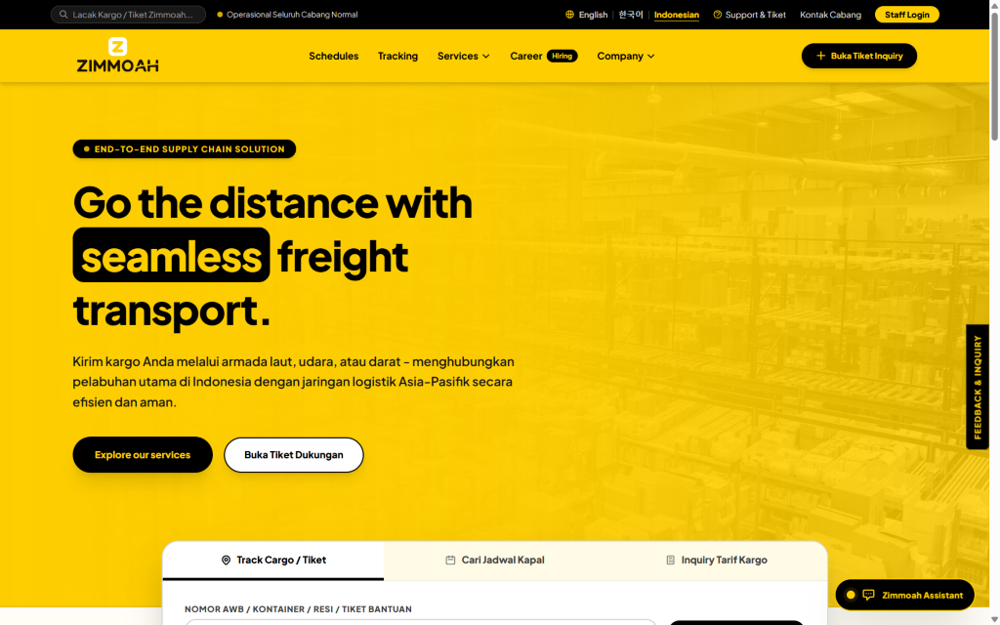
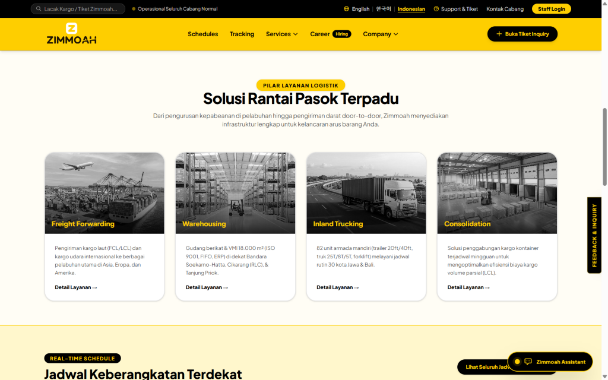
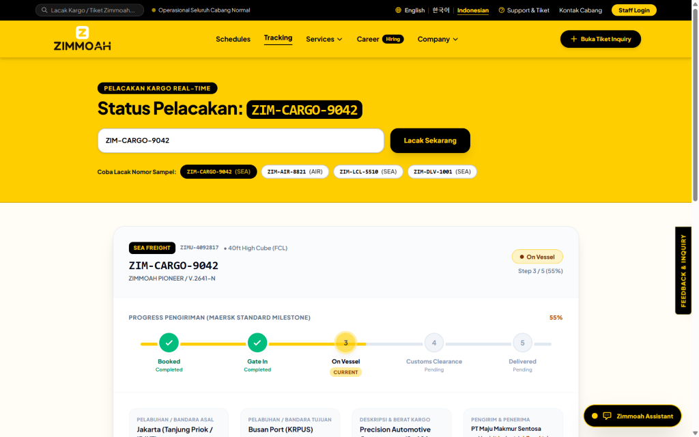
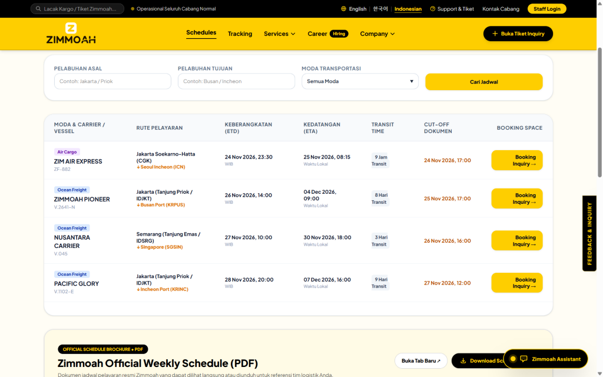
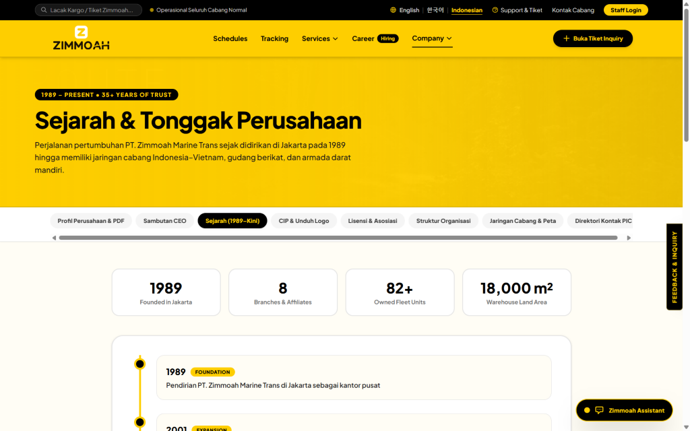
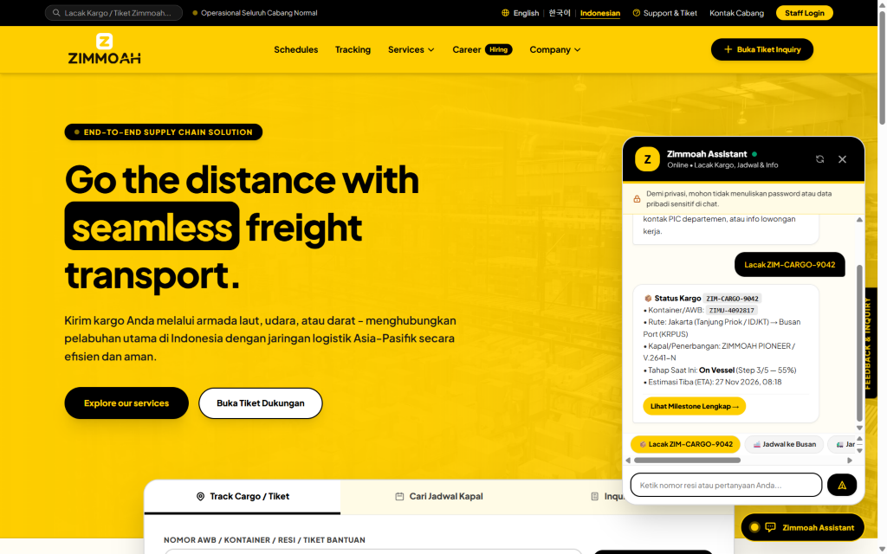

# Zimmoah Global Logistics Portal

Portal web logistik enterprise untuk **PT. Zimmoah Marine Trans (Zimmoah Global Logistics)** yang dibangun menggunakan **Laravel 13** dan **PHP 8.4**, dengan standar UI modern terinspirasi Maersk, palet warna kuning khas Zimmoah (`#FECE00`), integrasi konten & aset resmi `zimmoah.com`, **Zimmoah Assistant Chatbot**, serta modul **Email Ticketing System** dan **Career & Recruitment (HR ATS)**.

## Preview Tampilan Website



| Layanan Logistik (4 Pilar HD) | Pelacakan Kargo 5-Tahap Real-Time |
| :---: | :---: |
|  |  |

| Jadwal Pelayaran & PDF Resmi | Sejarah & Profil Perusahaan (1989–Kini) |
| :---: | :---: |
|  |  |

### Chatbot Publik — Zimmoah Assistant (Live DB + Opsional Gemini AI)



---

## Fitur Utama

- **Company Profile & Official Corporate Pages**: Data & aset resmi PT. Zimmoah Marine Trans mencakup CEO Message, History (1989–2018), Corporate Identity Program (CIP & download paket logo), License & Certificates, Organization Chart, 8 Cabang & Afiliasi beserta Google Maps, direktori PIC departemen, serta dokumen resmi `profile-170213.pdf` dan `Zimmoah Schedule.pdf`.
- **Services**: Layanan Forwarding, Warehousing, Trucking (82 unit armada & 30 rute kota Jawa–Bali), dan LCL Consolidation.
- **Schedules & 5-Step Cargo Tracking**: Pencarian jadwal kapal/pesawat (laut & udara) serta pelacakan resi/kontainer/AWB/tiket (`ZIM-CARGO-9042`, `ZIM-AIR-8821`) dalam 3 bahasa (`ID` / `EN` / `KO`).
- **Zimmoah Assistant (Chatbot)**: Widget chat publik yang langsung terhubung ke live database (lacak kargo, jadwal, 30 kota trucking, kontak PIC, lowongan aktif) dan siap dihubungkan secara opsional ke **Google Gemini AI** lewat `GEMINI_API_KEY` di `.env`.
- **Email Ticketing System**:
  - Formulir pembuatan tiket bantuan publik (`/tickets/create`) dan pelacakan status tiket (`/tickets/lookup`).
  - Portal tiket pelanggan aman dengan verifikasi token email.
  - Endpoint inbound email webhook (`POST /api/inbound-email`).
  - Dashboard Helpdesk Staff (`/admin/tickets`) dengan fitur balasan dua arah, *internal notes*, dan pemantauan SLA.
- **Career & Recruitment (HR ATS)**:
  - Daftar lowongan kerja (`/careers`) dan formulir lamar cepat dengan unggah CV/Resume terproteksi di private storage (`storage/app/private/resumes`).
  - Dashboard HR ATS (`/admin/careers`) untuk mengelola tahapan seleksi (*Applied -> Screening -> Interview -> Offered -> Rejected*), rating pelamar, catatan pewawancara, serta unduh CV aman via streaming terautentikasi.
- **Keamanan**: Security headers middleware (`X-Content-Type-Options`, `X-Frame-Options`, `X-XSS-Protection`, `Referrer-Policy`), validasi input ketat, proteksi CSRF, *rate limiting*, filter *prompt-injection* chatbot, dan private file storage.

---

## Persyaratan Sistem

- **PHP** `>= 8.3` (Direkomendasikan **PHP 8.4**) dengan ekstensi: `pdo_sqlite`, `sqlite3`, `mbstring`, `openssl`, `fileinfo`, `intl`, `zip`, `gd`, `curl`
- **Composer** `>= 2.x`
- **Node.js** `>= 20.x` & **NPM**
- **Git**

---

## Cara Menjalankan Project (Setelah Clone dari GitHub)

Ikuti langkah-langkah berikut di terminal (PowerShell / Git Bash / CMD):

### 1. Clone Repository
```bash
git clone https://github.com/zydanalfareza7/zimmoah-logistics-portal.git
cd zimmoah-logistics-portal
```

### 2. Install Dependency PHP & Frontend
```bash
composer install
npm install
```

### 3. Konfigurasi Environment (`.env`)
Salin file `.env.example` menjadi `.env`, lalu buat application key:
```bash
# Windows (PowerShell / CMD)
copy .env.example .env

# Mac / Linux / Git Bash
cp .env.example .env

# Generate App Key
php artisan key:generate
```
*(Opsional: tambahkan `GEMINI_API_KEY=...` dan `GEMINI_MODEL=gemini-2.5-flash` di `.env` untuk mengaktifkan jawaban AI percakapan bebas pada chatbot Zimmoah Assistant. Tanpa API key pun chatbot tetap berjalan penuh dengan live database.)*

### 4. Siapkan Database SQLite, Migrasi & Seeder
Project ini sudah dikonfigurasi menggunakan SQLite secara default agar mudah dijalankan tanpa perlu setting XAMPP/MySQL manual.
```bash
# Buat file database SQLite kosong (Windows PowerShell)
New-Item -ItemType File -Path database/database.sqlite -Force

# (Atau di Mac / Linux / Git Bash)
touch database/database.sqlite

# Jalankan migrasi tabel & data awal (seeder)
php artisan migrate --seed
```

### 5. Build Asset Frontend (Tailwind CSS & Vite)
```bash
npm run build
```
*(Untuk mode development dengan auto-reload CSS/JS, bisa jalankan `npm run dev` di terminal terpisah).*

### 6. Jalankan Server Lokal
```bash
php artisan serve
```
Buka browser dan akses: **http://localhost:8000**

---

## Akun Demo (Staff / Admin)

Akses halaman login admin di **http://localhost:8000/admin** menggunakan akun hasil seeder berikut:

| Role | Email | Password |
| :--- | :--- | :--- |
| **Super Admin** | `admin@zimmoah.com` | `password123` |
| **Helpdesk Agent** | `agent@zimmoah.com` | `password123` |
| **HR Recruiter** | `hr@zimmoah.com` | `password123` |

---

## Menjalankan Automated Tests

```bash
php artisan test
```

---

## Panduan Kerja Paralel Tim (Git Workflow)

Agar pengerjaan kelompok secara paralel rapi dan minim konflik (*merge conflict*):

1. **Selalu update branch utama dulu sebelum mulai ngoding:**
   ```bash
   git checkout main
   git pull origin main
   ```
2. **Buat branch baru untuk setiap fitur/tugas masing-masing anggota:**
   ```bash
   git checkout -b fitur/nama-tugas
   # contoh: git checkout -b fitur/email-notification
   ```
3. **Commit perubahan secara berkala:**
   ```bash
   git add .
   git commit -m "feat: deskripsi singkat perubahan"
   ```
4. **Push branch ke GitHub:**
   ```bash
   git push -u origin fitur/nama-tugas
   ```
5. **Buka Pull Request (PR)** di GitHub dari branch fitur Anda ke `main`, lalu minta teman satu tim untuk review sebelum di-merge.
